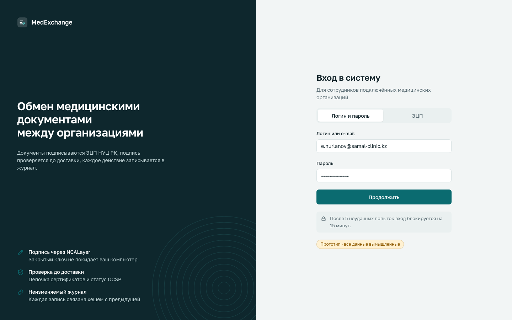
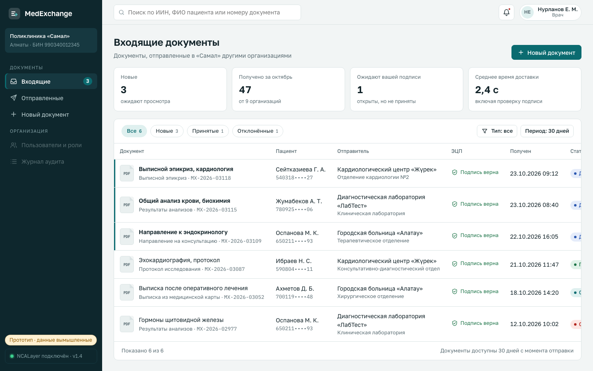
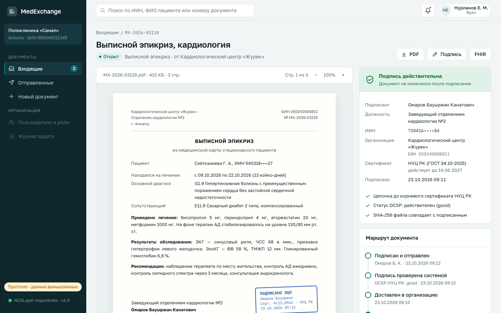
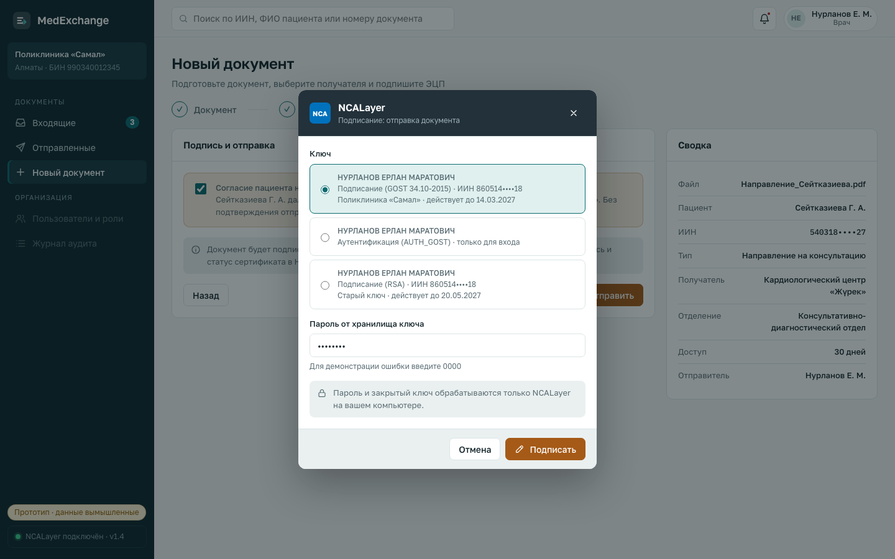
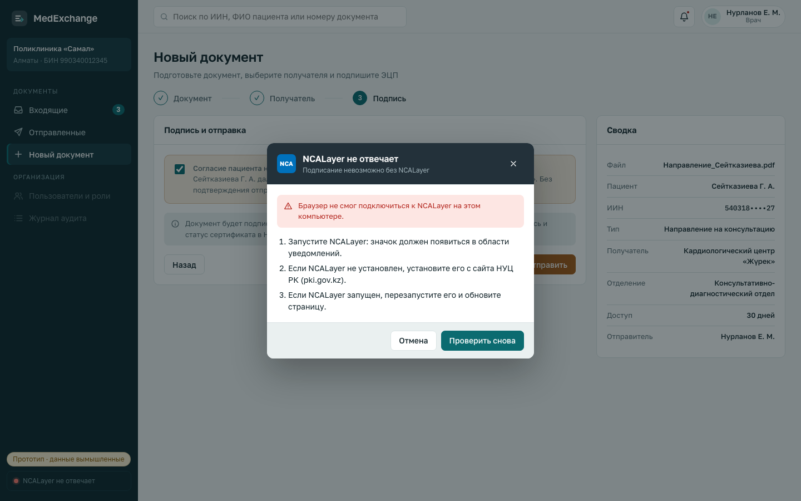
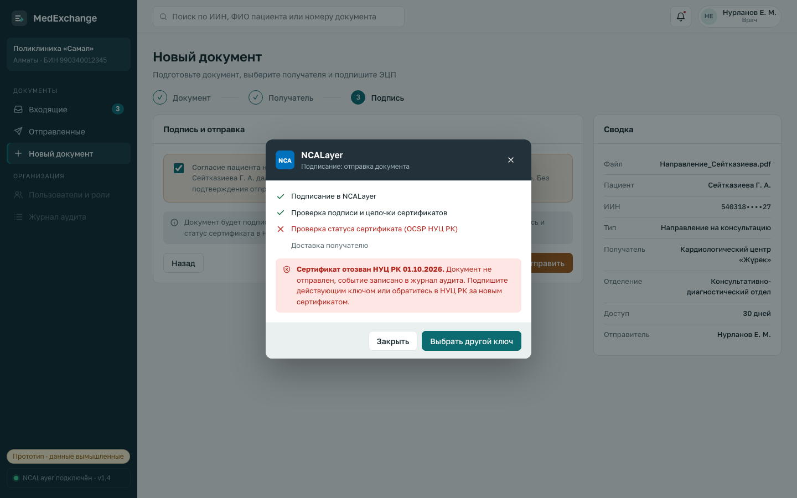
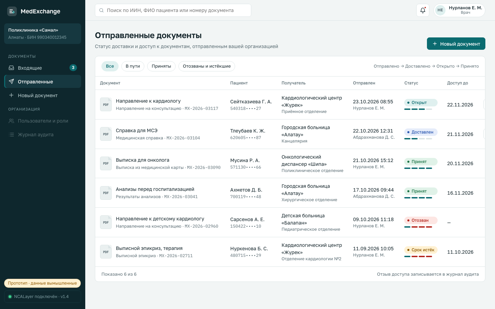
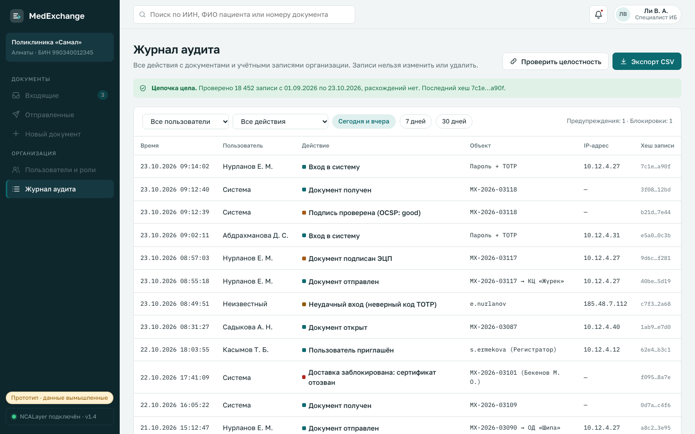
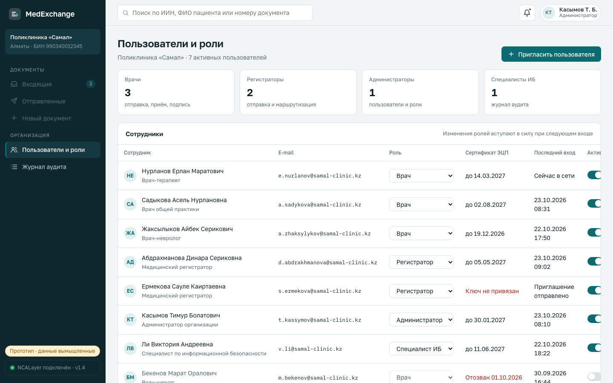

# UX Prototype

YouTrack: [DIP-6](https://medexchange-diploma.youtrack.cloud/issue/DIP-6) · Owner: Almasuly Damir

| Field | Value |
|---|---|
| Version | 0.2 (pre-defense 1) |
| Status | Draft for supervisor review |
| Related | [Requirements](06-requirements.md), [Use case diagram](../diagrams/export/use-case.png), [ADR 0005 — EDS](adr/0005-eds-signing-and-verification.md) |

## How to open

- **Open:** download [`prototype/src/index.html`](../prototype/src/index.html) (or clone the repository) and open it in Chrome, Edge or Firefox. No server or build is needed; without internet the page uses system fonts.
- **Screenshots:** [`prototype/screenshots/`](../prototype/screenshots/).
- **Direct links to screens:** add a token to the URL, for example `index.html#inbox`. Tokens: `login`, `totp`, `inbox`, `doc-MX-2026-03118`, `compose`, `compose-sign`, `ncl-off`, `sign-revoked`, `sent`, `audit`, `users`.

The prototype is a single HTML file with inline CSS and JavaScript. It is a clickable mockup of the web client, not an implementation: there is no backend, and NCALayer, signature verification and notifications are simulated. All organizations, people, IINs and documents are fictional.

**Why HTML instead of Figma.** The DIP-6 scope names Figma mockups. The prototype was built as clickable HTML because it shows real interactive behavior (validation, disabled actions until consent is confirmed, the signing progress, role-based access) and can be opened by the committee without a Figma account. Screenshots cover the static review. If the supervisor requires Figma, the screens can be recreated from the screenshots.

## Design decisions

- **Language:** Russian, as the main working language of the target users (NFR-09); Kazakh is planned for the final version.
- **Layout:** a sidebar with the user's organization and sections, a top bar with search, notifications and the user menu. The document view puts the original document next to the signature verification result, because checking authenticity is the main reason to open a received document (FR-09).
- **Status is always visible:** every list shows the status as a colored label, and sent documents also show a four-step progress bar (sent → delivered → opened → accepted).
- **EDS signing is a separate, explicit step** with its own dialog styled after NCALayer, so the user sees which key is used and that the private key stays on their computer (FR-07).
- **Sensitive data is masked:** IINs are shown as `540318••••27` in lists and the document view.
- **Role switch for the demo:** the user menu lets the presenter switch between Doctor, Registrar, Administrator and Security officer to show the role matrix (FR-02). In the real system the role comes from the account.

## Screens and scenarios

| Screen | Scenario (DIP-6) | Use case | Requirements | Screenshot |
|---|---|---|---|---|
| S1 Sign in | Sign in to the system | UC-01 | FR-01, FR-19, NFR-04 | [S1](../prototype/screenshots/S1-sign-in.png), [S1 TOTP](../prototype/screenshots/S1-sign-in-totp.png) |
| S2 Incoming | View incoming documents and their status | UC-05 | FR-11, FR-13 | [S2](../prototype/screenshots/S2-incoming.png) |
| S3 Document | Open, verify and sign a document | UC-06, UC-07 | FR-09, FR-10, FR-12, FR-17 | [S3](../prototype/screenshots/S3-document.png) |
| S4 New document | Send a document to another medical organization | UC-03, UC-04 | FR-04 – FR-08, FR-14 | [S4](../prototype/screenshots/S4-new-document.png), [S4 signing](../prototype/screenshots/S4-sign-ncalayer.png), [NCALayer not running](../prototype/screenshots/S4-error-ncalayer-not-running.png), [certificate revoked](../prototype/screenshots/S4-error-certificate-revoked.png) |
| S5 Sent | Track status and revoke access | UC-08 | FR-11, FR-14 | [S5](../prototype/screenshots/S5-sent.png) |
| S6 Audit log | Review the audit log | UC-09 | FR-15, FR-16, NFR-05 | [S6](../prototype/screenshots/S6-audit-log.png) |
| S7 Users and roles | Organization administrator: manage users and roles | UC-02 | FR-02, FR-03 | [S7](../prototype/screenshots/S7-users-roles.png) |

### S1 Sign in

The user enters a login and password, then a six-digit TOTP code. The "EDS" tab shows the alternative sign-in with an authentication certificate through NCALayer (FR-19, Could). A hint states the lockout rule (NFR-04).

### S2 Incoming documents

The doctor's start screen. Summary cards show new documents, documents waiting for acceptance and the average delivery time. The table lists each document with the patient (masked IIN), the sender organization and department, the signature check result, the time received and the status. Unread documents are marked with a bar and bold title. Filter chips and the search field (IIN, patient name or document number) cover FR-13.

### S3 Document

Opening a document changes its status to "opened" for the sender. Left: the original document as received. Right:

- **Signature verification** (FR-08, FR-09): signer, position, IIN, organization and BIN, certificate issuer and validity, signing time, and three checks: chain to the NCA RK root, OCSP status, file hash.
- **Document route** (FR-11): signed and sent → verified → delivered → opened → accepted or rejected.
- **Actions** (FR-10): "Accept and sign with EDS" opens the NCALayer dialog; "Reject" requires a reason. Only a doctor sees these actions; a registrar sees a hint.
- **Details** (FR-12): FHIR `DocumentReference` fields, access period, consent and SHA-256. Downloads: PDF, CMS signature, FHIR JSON.

### S4 New document

Three steps with a live summary on the right:

1. **Document:** file (PDF, JPEG, PNG up to 25 MB), patient IIN with 12-digit validation, name, type, title, comment (FR-04). "Next" stays disabled until the required fields are valid.
2. **Recipient:** search in the directory of connected organizations, optional department, access period of 7, 30 or 90 days (FR-06, FR-14).
3. **Signature:** the patient consent checkbox (FR-05). "Sign and send" stays disabled until consent is confirmed.

The NCALayer dialog asks for the signing key and the key store password, then shows the progress: signing in NCALayer → signature and certificate chain check → OCSP check → delivery (FR-07, FR-08). After delivery the user lands on S5 with the new document at the top.

#### Signing errors

The same dialog is used for sending (S4) and for accepting a received document (S3), so the errors below appear in both scenarios.

| Error | How to show it in the prototype | What the user sees | Requirement |
|---|---|---|---|
| NCALayer is not running | Click "NCALayer подключён" at the bottom of the sidebar, then sign | A dialog with three steps to start or install NCALayer and "Check again" | FR-07 (acceptance criterion) |
| Authentication key chosen | Select the key "Аутентификация (AUTH_GOST)" | A hint that this key is only for sign-in; "Sign" is disabled | FR-07 |
| Wrong key store password | Enter `0000` as the password | An error under the field with the remaining attempts | FR-07 |
| Certificate revoked | Select the old key "Подписание (RSA)" and sign | The OCSP step fails; the document is not sent, the event is written to the audit log, the user can choose another key | FR-08, FR-15 |

### S5 Sent documents

All documents sent by the organization with recipient, sender, status, progress bar and access end date. Documents still in transit or opened can be revoked after a confirmation that explains the consequence (FR-14).

### S6 Audit log

Available to the administrator and the security officer. Each record has time, user, action, object, IP address and the record hash. Color marks the kind of event: EDS operations, warnings (failed login), blocked actions (delivery blocked because of a revoked certificate). "Check integrity" verifies the hash chain (NFR-05); the security officer can export CSV (FR-16).

### S7 Users and roles

Available to the organization administrator only. Shows counts per role, and for each employee the e-mail, role (editable), EDS certificate status, last sign-in and an active switch. "Invite user" sends an invitation with a role (FR-03). Role changes and deactivation are written to the audit log.

## Main walkthrough for the defense

1. Sign in (S1) → the inbox opens (S2) with three new documents.
2. Open the discharge summary from the cardiology center (S3): show the signature check and the route, then "Accept and sign with EDS".
3. Go to "New document" (S4): "Fill with sample", choose the cardiology center, confirm consent, sign. Show that the document appears in "Sent" (S5).
4. Show a failure: sign another document with the old RSA key. Delivery is blocked because the certificate is revoked.
5. Switch the role to Security officer in the user menu: S6 shows the new records, including the blocked signature; run "Check integrity".
6. Switch to Administrator: S7, deactivate a user; note that document sections are now unavailable for this role.

## Limitations and next steps

- Data, NCALayer and the signature service are simulated; behavior on screen is the intended behavior from [06-requirements.md](06-requirements.md).
- Not covered yet: Kazakh language, settings and the user profile, a document whose file hash does not match on download (FR-17).
- The prototype has not been tested with users yet. A usability test with 3–5 participants (task: send a signed document) is planned together with the interviews ([interview guide](02-evidence/interview-guide.md), question 16); results go to [02-evidence/interviews.md](02-evidence/interviews.md).
- The web client in `apps/web/` will be built from these screens after the frontend stack is chosen in DIP-3.
